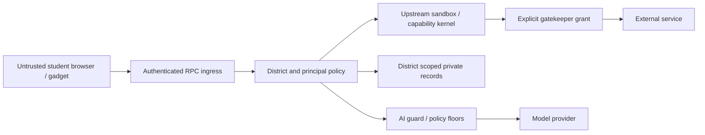

# ADR 0001: Thin EducateOS product fork

Status: proposed. This branch changes governance only.

## Decision

Retain Cloudflare OS as the sandbox/RPC kernel. Keep educational vocabulary,
policy, district administration, content and integration behavior in EducateOS
packages. Prefer existing capability/configuration mechanisms to new kernel APIs.
Review shell adaptations separately from kernel changes. Preserve all existing
education behavior until equivalent replacement and security evidence exists.

A permanently diverging kernel increases security maintenance costs. An immediate
rewrite risks regressions. Incremental extraction makes coupling measurable while
preserving working features. This decision does not authorize those extractions.

## Extension contracts

| Boundary | Contract and required evidence |
| --- | --- |
| Vocabulary | Existing `@educateos/contracts` owns IDs, scopes, principal lifecycle, authority and audit vocabulary. Import rather than duplicate; test consumer compatibility. |
| Policy | Authenticated server enforces district, role and resource policy at every ingress. UI visibility grants no authority. Test inactive principals and cross-district denials. |
| RPC | `workshop-shared` remains the actual contract: documented exports, runtime RPC validation, disposal and pipelining. No mirrored interface casts; separate kernel review slice. |
| Integration | Gatekeepers expose least-privilege capabilities and retain secrets. No self-asserted ambient authority. Preserve existing nonce/ticket handoff and reconnect semantics; test replay and revocation. |
| AI | Preserve AI guard and policy floors across every ingress. Failure must never create a student bypass. Prove coverage before caller migration. |
| UI shell | Render domain state via authorized contracts. No private records in assets, logs or client authorization rules. |
| Release | Generate worker configuration from source. Libraries do not become deployable by name. No credential/deployment changes in this ADR. |

## Security trust boundary

The graph expresses required checks, not a claim of one existing physical gateway.
Server authentication, tenant scoping and capability checks remain authoritative.
Never trust a client-supplied district alone. Grade authority and identity sources
remain explicit. Generated gadget code is untrusted. Logs exclude prompts, tokens
and private record bodies. The inventory reads Git paths and blob IDs only.

## Baseline disposition

The existing tree delta is grandfathered in `exceptions.json`, bound to exact
before/after blob IDs. These entries retain existing behavior; they are not an
independent security approval. Reviewing this PR includes reviewing that baseline
policy. Tip-to-tip differences include upstream-only changes when upstream is
ahead, so inventory entries do not assert product ownership.

Never auto-refresh this baseline in CI. New or changed kernel entries require a
file-specific rationale, alternatives/security implications and review reference,
plus the new fingerprint. Independent reviewers assess code and manifest together;
a string is not proof of human approval. Administrators should require this check
and independent review in branch protection. This branch does not change or claim
the presence of those settings.

## Consequences

Moving upstream may turn CI red until maintainers reconcile the delta. Renames
out of kernel remain governed; unknown packages default to kernel. Repository
files default to release/governance. This maintenance gate is not runtime security
or a transitive dependency analyzer. Stale exceptions cannot approve new content.
