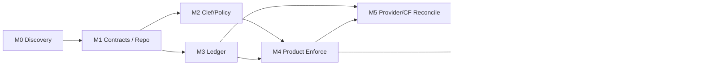

# 04 — Milestones, PR Slices, Dependencies and Rollout Gates

## 0. Execution principles

- One independently deployable **Hall Monitor** service and SDK shared by PlayTrek and EducateOS; it is not a hidden PlayTrek-only package.
- One reusable cost contract with **billing-owner-local** budgets/ledger. Do not make `educateos.io` the compulsory authoritative student-data or AI path.
- Design **cost receipts from day one**, before large-scale student moderation. Otherwise later inference reconciliation will require brittle forensic accounting.
- Maintain full K–12 content-vetting coverage but enable direct student AI only under separately configured grade 6–12 policies. Educator-only product value remains available without student AI.
- Prioritize a narrow vertical slice with **all new calls accounted for**, rather than building a sophisticated dashboard that cannot explain its totals.
- All percentage/latency metrics below are *proposed release gates*, subject to measurement and explicit privacy/safety approval; none are claims of present operational performance.

## Milestone map

| Stage | Name | Output | Dependency | Gate |
|---|---|---|---|---|
| M0 | Baseline and ownership | Verified existing call paths, workload/cost inventory, data boundaries, ADRs | None | Scope signed off |
| M1 | Shared contracts + independent repo | Hall Monitor repo/SDK/typed policy and cost receipts; fixtures | M0 | Contract tests pass |
| M2 | Clef and evaluator runtime | Stateless Worker; Flash/Clef adapters; deterministic policies; unit usage receipts | M1 | Safety/quality evaluation suite passes gate |
| M3 | Budget ledger foundation | Price books, idempotent event ingestion, reserve/settle, trial reports | M1 | Financial invariants hold |
| M4 | Product integrations | PlayTrek content paths and EducateOS all input/agent paths enforce policies; adapters reuse SDK | M2 + M3 | No tested bypasses |
| M5 | Provider and Cloudflare reconciliation | AI Gateway/provider adapters; Workers AI Neurons; CF account metrics | M3 + M4 | Explain vendor-to-ledger variance |
| M6 | Admin configuration and dashboards | Per-org policy templates, user/course budgets, audit, safety incident separation | M4 + M5 | Pilot administrators can configure without CLI |
| M7 | Controlled production-readiness pilot | Shadow-mode then opt-in enforcement, cost study, fail-safe and privacy reviews | M6 | Readiness board approves |
| M8 | Shared-service hardening | Optional multi-account managed hosting, signed releases, contracts, versioned SDK rollout | M7 | Two-client/tenant operating tests |

Parallel tracks: **Policy/safety (M1 → M2 → M4)**, **cost/finance (M1 → M3 → M5)**, **product adoption (M4 → M6 → M7)**. Independent packages let these tracks progress concurrently while integration tests exercise fixed contracts.

## M0 — Verify sources of truth and decide ownership (P0)

**Deliverables:**

- [ ] ADR: Hall Monitor separate repository and independently deployable Worker; sovereign vs managed data-plane placement.
- [ ] Inventory PlayTrek Hall Monitor evaluators and all text/media generation call sites, including old episode pipelines and `aiGenerations` usage fields.
- [ ] Inventory EducateOS `newChat`, `sendChatMessage`, `steerRunningTurn`, slash commands, external agent messages, Gadget model bindings, and model-router accounting.
- [ ] Trace Cloudflare AI Gateway, direct Workers AI and third-party API routes. Find paths that cannot expose reliable token usage or billed provider identifiers.
- [ ] Confirm billing ownership, credentials, retention and DPA for managed and sovereign modes.
- [ ] Lock a **synthetic** fixture dataset: 2 fake institutions, 3 classes, 12 teacher activity profiles, 6–12 student profiles, benign/harmful/sensitive/ambiguous prompts and multilingual variants.
- [ ] Freeze pricing baseline and labels from existing workbook; add explicit Hall Monitor assumptions without mutating original scenario values.

**Exit:** Architecture decision record, ingress-path matrix, initial provider tariff sources, acceptance tests written, and `source_of_truth` assignment for each dollar category.

## M1 — Service repository, schemas and SDK (P0)

Proposed PRs:

- **HM-01 Contracts:** `@gmacko/hall-monitor-contracts` with versioned request/response schemas, enum/opaque ID types, error codes, evaluation kinds, policy revision and price/cost receipts.
- **HM-02 Worker skeleton:** `/v1/evaluations`, health, OpenAPI, signed service-auth, tenant context, stub evaluator, idempotency and local `workerd` tests.
- **HM-03 Product client:** TS fetch client with service URL/binding abstraction, retry of idempotent requests only, typed timeouts and safe metadata.

**Exit:** A fake PlayTrek client and fake EducateOS client call the exact same Worker/SDK in tests, with zero product-specific imports in shared packages. Contract breakage CI test fails when a schema version is incompatible. Service can run in a customer's account or a managed account with explicit configuration.

## M2 — Moderation & evaluation engine (P0)

Proposed PRs:

- **HM-04 Rules and profiles:** Policy inheritance/validation, deterministic rule engine, `allow/coach/hold/block/support`, grade/role safeguards, provenance and explainable reason codes.
- **HM-05 Clef providers:** Workers AI adapter using Clef-flash by default, optional Clef/omni, request/token/neuron receipt, timeouts and finite escalation.
- **HM-06 Content evaluators:** Adapt PlayTrek's generic content/rule/evaluator engine; maintain per-product plugin adapters for episode rules, EducateOS resources and assignment rubrics.
- **HM-07 QA suite:** Multilingual, prompt-injection, literary-context, academic-integrity, distress, media, external-source and model-error test fixtures; signed policy/model-version regressions.

**Exit:** For each supported policy profile, reference tests produce allowed actions and reason codes; classifier uncertainty/outage paths are exercised; evaluated requests emit cost receipts; default logs never contain raw child/student payloads. Actual false-positive/false-negative data must be reported before setting thresholds for deployment—no invented universal threshold.

## M3 — Cost ledger, reservations and finance primitives (P0)

Proposed PRs:

- **COST-01 Price books:** Immutable provider/SKU rates, effective dates, cache modifiers, funding/allowance accounting, price-update validation.
- **COST-02 Usage ingestion:** Signed usage events, per-attempt IDs, content-free lineage fields, integer nanodollar arithmetic, deduplication and audit append log.
- **COST-03 Budget account:** Atomic organization/school/course/teacher/student/safety pools with reserve/settle/release, idempotent retries and expiry reconciliation. Integrate into a test Worker's full request lifecycle.
- **COST-04 Ledger API/SDK:** Billing-owner integration library, quota preview and client-specific attribution; export canonical CSV/JSON for finance.

**Exit:** Concurrent reserve/settle test cannot overspend, all attempted inference has a pending/settled/unknown cost state, duplicate logical events are charged once, rerun in a fresh instance reconstructs balances and close-out; no raw prompt data in ledger.

## M4 — Integrate both products, with bypass coverage (P0)

Proposed PRs:

- **PLAY-01:** PlayTrek Episode Composer → shared content evaluation adapter. Preserve current local validators as fallback/dual-run during migration; emit both generative model and Hall Monitor cost receipts.
- **PLAY-02:** Optional PlayTrek runtime interaction/response moderation and audit. Wire model call paths not limited to the already existing `hallMonitor` code; prevent direct provider bypass when policy enabled.
- **SCH-01:** EducateOS trusted-server Hall Monitor shim for chat, steering, file/attachment ingress, agent/Gadget events and tool/connector access. Implement narrow kernel changes with separate UI integration and patch docs.
- **SCH-02:** EducateOS student/teacher policy context and budgets: verified principal, course/term and active role settings. Distinguish coursework from private personal spaces.
- **INT-01:** Product-wide coverage tests enumerate all ingress and inference paths and prove mandatory guards for enabled student modes.

**Exit:** Synthetic PlayTrek session + synthetic EducateOS English/Biology activity run on one versioned Hall Monitor SDK; all model calls and safety evaluations are visible in each billing-owner ledger; sandbox escape or bypass tests fail closed for child AI.

## M5 — Reconcile actual provider/Cloudflare billing (P0/P1)

Proposed PRs:

- **COST-05 Provider usage normalization:** Gateway log IDs, direct provider usage fields, cache/read/write semantics, streaming partial completions, retries and cost-unknown recovery.
- **COST-06 Cloudflare account metrics:** Workers CPU/requests, Durable Objects active duration, D1, R2, Artifacts, Dynamic Workers, Containers, AI Search, Workers Logs. Import available accounts' billing/analytics without granting Hall Monitor broad root account admin rights.
- **COST-07 Account billing allocator:** Apply shared Workers AI 10K Neurons/day, account Paid base, included storage/requests and contract adjustments **once per account**; produce gross and net tables and invoice discrepancy reports.
- **COST-08 Workbook bridge:** Persist Scenario Assumptions/Measured Usage/Price Book IDs, build and verify an automated comparison against the October base workbook for 5 scenarios.

**Exit:** A known fixture month's raw events, provider records and synthetic Cloudflare invoice reconcile without double counting; report residuals and unknown buckets. Live pilot read-only import supported under least-privilege credentials. No claim of request-perfect reconciliation from aggregate Cloudflare invoice data.

## M6 — Educator/admin controls (P1)

Proposed PRs:

- **UI-01:** Guided org profile wizard for educator-only, hybrid grades 6–12 student AI, PlayTrek content authoring. Pick Clef profile, AI model tiers, review approvers and data-retention level; see cost projection *before* activation.
- **UI-02:** Funding and model policies: teacher $15/$30, student $2/$5, Assessment shared funding, separate Hall Monitor safety reserve, override and exception approvals, immutable history and rollback.
- **UI-03:** Cost dashboards for billing owner/teacher; scenario forecasts; anomaly warnings; department/class/model usage; actual invoice vs forecast; no private raw student chat.
- **UI-04:** Restricted safety-review workflow and reviewer audit, not a generalized “monitor all student conversations” page.

**Exit:** Nontechnical co-op admin configures profiles, tests using synthetic messages, activates a class, sees warning for >80% projected budget utilization, checks actual usage and exports one monthly cost report with zero Cloudflare dashboard navigation after authorization.

## M7 — Safe rollout, evaluation and benchmark gates (P1)

**Plan:** Synthetic shadow mode → consenting educator-only content mode → small opt-in staff beta → optional grades 6–12 supervised pilot after legal/privacy/security review. Children do not serve as unconsented safety-evaluation training data. Shadow mode must not silently collect raw student data without a lawful basis and explicit institutional contract.

- [ ] Safety: representative benign/literary/academic/mental-health/adversarial fixtures, human-reviewed false positive/negative calibration, accessibility and multilingual tests; define blocking thresholds per risk class.
- [ ] Privacy: legal/contractual basis, child consent context, Gateway payload disabled, service data retention/erasure, cross-account provider DPAs, safeguarding incidents routed only to authorized personnel.
- [ ] Economics: observed `moderated_inputs/model_calls` ratio, avg/p95 input tokens, escalation rates, retries, drift between ledger/provider/account invoices, optional evaluation labor costs.
- [ ] Reliability: injection/role spoofing, root outage, Hall Monitor failure, Workers AI 429, policy downgrade attempt, provider invoice mismatch, budget exhaustion during distress disclosure.
- [ ] Performance: record baseline p50/p95 classification latency and total added user-perceived latency per deployment; set **measured** SLO targets after fixtures, don't assert a vendor guarantee.
- [ ] Governance: document approved student scopes and teacher-visible logs; confirm no automated discipline or subjective high-stakes grade based solely on Clef.

**Exit:** Signed launch checklist with actual data, unresolved risks, incident runbook, written district/co-op approval, override conditions and a rollback drill. Failures in privacy/safeguarding block student rollout, not educator-only local planning.

## M8 — Reusable service operations and federation (P2)

- **OPS-01:** Signed, versioned policy pack publication; rolling/rollback deployment independent from PlayTrek/EducateOS releases; compatibility registry and SDK deprecation windows.
- **OPS-02:** Managed multi-tenant endpoint if commercially needed: per-tenant auth, budgeting, rate isolation, scope-aware request logs, chargeback; no student payload routing via fleet root.
- **OPS-03:** Dedicated district local deployment automation and resilience tests; root offline continuity and independent control of retention.
- **OPS-04:** Evaluation/benchmark pipeline so model/version upgrades are gated by regression evidence and cost changes.

**Exit:** Two products on compatible versions of the service operating in separate Cloudflare accounts, with reproducible upgrades, rollbacks, cost allocation, legal controls and independent failure domains.

## Dependencies and critical path

**Critical path for first actual EducateOS/PlayTrek shared demo:** M0 → M1 → M2/M3 → M4. Do *not* gate the initial synthetic demo on commercial invoices, marketplace, direct student AI, or automatic SEL analysis. **Critical path to paid service:** add M5, M6 and measured M7.

## Staffing and relative effort (not a time estimate)

| Track | Size | Work areas |
|---|---|---|
| Contracts & service runtime | Medium | Worker HTTP, auth, Effect/Zod types, adapters and client SDK |
| Clef/evaluator & safety QA | Large | Grade-aware policies, plugin isolation, quality tests, emergency routing |
| Atomic metering/ledger | Large | Price books, concurrency, retry semantics, accounts, financial audit |
| PlayTrek integration | Medium | Extract content validators; usage events across generation pipelines |
| EducateOS integration | Large | Low-diff kernel enforcement, identity, Gadget and external calls |
| Billing & Cloudflare reconciliation | Large | Provider APIs, tariffs, account-vs-tenant allocation, anomalies |
| Admin/report UX | Medium–Large | Typed form engine, budget/permissions, dashboards, review routing |
| Student pilot governance | Large cross-functional | Curriculum, privacy, legal, safety, security, operations |

**Avoid an engineering trap:** do not interpret `Hall Monitor inference ~ $1/co-op/month` as the engineering cost of a safe classroom moderation product. Spending on safety research, red-team testing, human escalation and support is not a model token line item.

## Definition of done across all milestones

- Types/interfaces committed with unit tests, doc-commented public APIs and backward compatibility policy.
- Feature guarded by owner policy; no student AI auto-enabled through rollout.
- Health, rollout and budget monitoring covered in deployment runbook.
- New model call site cannot ship without metering + authorization + moderation coverage declaration.
- Synthetic example/test proves expected input, output, event and invoice accounting.
- Tenant data and student content are absent from unrelated tenant/root logs.
- Graceful rollback and replay/reconciliation are covered by automated tests.
