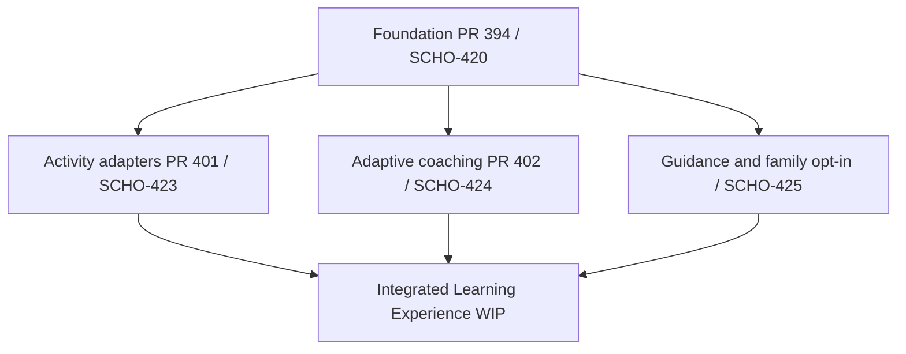

# Learning Experience integration (WIP)

This integration is stacked on the unmerged SCHO-420 foundation PR #394, branch
`SCHO-420-personalized-learning-planner`, foundation head `4e9c948c351e04303b56e4a9bec040cf3f84beda`.
It combines committed producers only; no other worktree was edited.

Dependency graph:

Producer commits: adapters `c8c75fd8951fbe0d8c6e02d9f14dee7ea0331c13`, adaptive
`d133e4a5c4b129837a4bf740066652f2893f951c`, guidance
`85f6e6ee73afa24b7b16205c2a44a64420fe849f`. Each is integrated as a separate commit.
The newer foundation's home-learning routes and Classroom setup navigation are retained.

## Integration boundaries

- `student.plannerShare` optionally accepts an opaque `activityEvidenceId`. A deployment-injected
  host resolves the original evidence, expected consent-bound request and authenticated replay-safe
  inbox. No host is configured by default. Student, class, district, exact evidence contract and
  assistance must match; hashes alone do not establish authenticity. The host retains original
  evidence in its authorized storage. Planner persistence keeps only its digest, coverage, surface
  availability and assistance, with the explicit requires-teacher-verification claim.
- Complete activity capture never becomes independent assessment. Student practice, unseen teacher
  assessment and a teacher recommendation remain separate. Mixed assistance is preserved; it cannot
  be relabeled independent. No grade or assignment is automatically created.
- Guidance and learner knowledge share the same independent-review evidence floor. A later hold
  on another plan supersedes an earlier recommendation. Grade 7 pathways are recognized. Teacher
  drilldown reuses planner response/review schemas so evidence provenance and assessment conditions
  survive typed response validation.
- Guardian guidance grants remain default disabled per relationship. Guardian views contain only
  permitted coarse summaries. Private goals, chats and source data do not enter shared evidence.
  The K–5 model guard remains in place; CASEL invitations have no profiling or psychological scores.

## Local validation

All commands used pnpm, with bounded Vitest runs using `--maxWorkers=2`.

- District planner/adaptive/AI/guidance/home-learning: 53 tests passed in 5 files.
- New cross-workstream evidence integration plus guidance: 18 tests passed in 2 files (17 overlap
  with the district run, one new integration test).
- Activity adapters: 35 passed. Teacher UI: all 112 passed in 23 files.
- Student planner/guidance/home-learning UI: 9 passed. Admin guardian guidance UI: 5 passed.
- Policy: all 223 passed. Contracts: all 62 passed.
- Standard `tsc --noEmit`: district-app, student-ui, teacher-ui, admin-ui, contracts, policy all pass.
- `pnpm lint` passed lint, script types and generated Worker configs, then failed because the new
  dependency made `deploy/watch-paths.json` stale. Regenerated and checked separately. The full
  workspace build was intentionally not run. No CI success is claimed from local checks.

An unpublished conflict-resolution mistake was corrected before publication. Final app/routes/router
changes are additive integrations with a single dispatcher for core, guardian, guidance and home
learning routes. No unrelated multi-thousand-line deletion remains.

## Remaining boundaries

This is a reviewable WIP, not a production rollout. The foundation and producer PRs remain unmerged.
No deployment was performed. Real paired Studio/Gadget transports, durable receipt authentication
and evidence retention must be supplied by a trusted host before enabling the activity evidence seam.
No new UI for pairing/uploading adapter evidence is claimed; the tested seam is the typed sharing API.
The guarded model adapter is also deployment-injected and remains absent by default. Browser focus,
visual layout, live vendor behavior and production health were not verified. CI must be evaluated
against the final pushed revision. Kanbanger authentication was unreliable in this isolated session;
existing SCHO-420/423/424/425 tracking is retained, with no completion or deployment claim.
