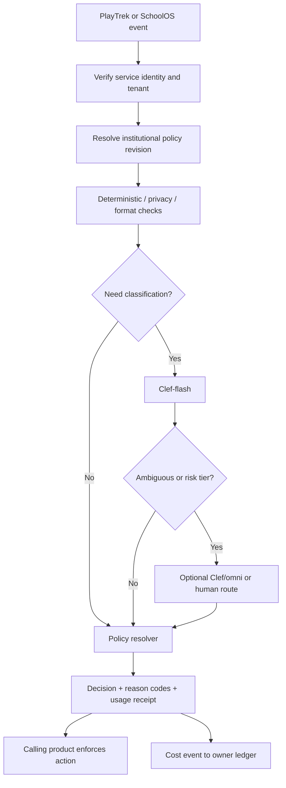

# 01 — Shared Hall Monitor Service: Architecture and API

**Design status:** Proposed implementation. The current PlayTrek code contains Hall Monitor *content quality* evaluators; it is not yet an independent moderation service. The Cloudflare OS fork has a Clef-compatible decision-model API; that is not yet a mandatory user-input policy interceptor.

## 1. Mission and explicit non-goals

Build a separately deployable, reusable moderation and evaluation service for **PlayTrek** and **SchoolOS**. It should answer: *Is this content or requested activity appropriate for this product, user role, curriculum context, and configured institutional policy, and what should happen next?* It should never decide who is authorized to read a student's files, impersonate a teacher, or award final grades.

Three independent evaluation families share transport, config, audit and metering:

1. **Interaction Hall Monitor:** Incoming user text/attachments, tool-generated messages, student-facing output, prompt-injection attempts, age/grade-aware tutoring guardrails, and special safeguarding routing.
2. **Content Hall Monitor:** Teacher-produced, publisher-imported, AI-generated and PlayTrek-generated learning materials: rights status, provenance, age suitability, standard alignment, accessibility, answer leakage and game/lesson-specific rules.
3. **Assessment Hall Monitor:** Validate evaluation manifests, rubric criteria, evidence provenance, grader output shape and confidence. Assessment CI remains a separate orchestrator; a classifier is *not* the gradebook authority.

Do not conflate an academic research question about a sensitive topic with harmful intent. Do not interpret Clef outputs as clinically validated behavioral diagnoses. Ensure a safe non-AI path on interruptions.

## 2. Deployable units

```text
Proposed independent repo: gmackie/hall-monitor/
  packages/
    contracts/              # Zod or Effect Schema; versioned API/ABI
    core/                   # Evaluator orchestration and rules
    policy/                 # Inheritance, floors, explainable decisions
    clef/                   # Workers AI decision model adapter
    evaluators/             # Deterministic and optional model-based plugins
    costing/                # Price book client, usage receipts and cost contracts
    client/                 # TS fetch client, retry and batch helpers
    test-fixtures/          # Synthetic multilingual, educational, adversarial cases
  apps/
    worker/                 # Cloudflare Worker HTTP API, signing, auth, rate limits
    admin/                  # Policy/evaluation console later
  examples/
    schoolos-district/
    playtrek-deployment/
  docs/
```

**Deployment profile A — Sovereign (preferred for districts).** Standalone Hall Monitor Worker bound to the district's own Workers AI and AI Gateway, optionally service-bound to SchoolOS within the *same* Cloudflare account. Policies and metering remain district-local; no student data travels via `schoolos.dev`. It can be upgraded as an independent Worker even if deployed from the same installer.

**Profile B — Managed co-op.** Hall Monitor Worker in the managed education data plane, authenticated per-organization. Multi-tenant settings, PII processing and log access are explicitly isolated. Root fleet metadata stays separate. A dedicated managed account per customer is an option for stronger isolation.

**Profile C — PlayTrek independent.** PlayTrek invokes the same versioned service/SDK from its own deployment account, or a contracted shared endpoint. PlayTrek's existing evaluator implementations can be adapted gradually; there is no reason to migrate user sessions or private PlayTrek tables into Hall Monitor.

**Cross-account calls:** HTTPS with signed short-lived service assertions. Cloudflare service bindings are for services within the same account; don't assume direct cross-account bindings. Fail closed on unauthorized caller scope; apply separate failure behavior for classifier timeouts.

## 3. Core request flow



Hall Monitor should execute classification *before* the generative request when student input is moderated. The caller must not be able to claim the request is safe merely by providing a role string; it derives identity/role authorization from a verified session and local enrollment data. Under limited circumstances, anonymous public content can be evaluated with no student principal. The service authenticates the invoking product's authority for the proposed evaluation profile.

### Decision categories

| Action | Runtime meaning | Use cases |
|---|---|---|
| `allow` | Continue with approved capability scope | Standard learning request |
| `coach` | Change to guided mode, suppress prohibited answer style, or require a student attempt | Help with graded work, overly direct answer requests |
| `hold` | Do not execute generative request; queue content for designated, privacy-scoped human review | Copyright uncertainty, safety-critical publishing |
| `block` | Deny prohibited operation with respectful explanation | Credential theft, direct bypass attempts, dangerous generation requests |
| `support` | Route to supportive safety UX and applicable institutional safeguarding process | Personal distress disclosures; never just a generic rejection |

One call can produce several findings. The deterministic resolver chooses the final action using versioned precedence rules (e.g., `support` for a genuine distress disclosure; `block` for a malicious tool invocation); no model should invent the final action string unboundedly. Every result includes `policyVersion`, `evaluatorVersion`, `modelId`, `reasonCodes`, `uncertain`, and `usageReceipt`.

## 4. API, SDK and versioning

Recommended **HTTP** surface (wire contracts and headers are proposals):

- `POST /v1/evaluations` — synchronous policy checks for `interaction.input`, `interaction.output`, `content.candidate`, `assessment.evaluator-result`.
- `POST /v1/evaluations:batch` — bounded content reviews, not real-time chats; asynchronously enqueue when expensive.
- `GET /v1/capabilities` — supported evaluator bundles, model inputs, policy schema versions, safety profiles; no secret details.
- `GET /v1/health` — public minimal status (does not reveal tenant data).
- `GET /v1/ready` — protected readiness health with provider reachability.
- `GET /v1/receipts/{evaluationId}` — protected, idempotent usage receipt retrieval.

Use `application/json`, opaque IDs, and explicit `X-Idempotency-Key`. Rate-limit at service edge and tenant scope. Use signed service identity (JWT with `iss`, `aud`, `exp`, `jti`, `scope`, `tenant`), rotate keys, and pin the accepted client audience. The caller's student ID must come from the caller's trusted identity system; Hall Monitor sees an opaque, tenant-scoped principal only if needed for the policy/metering scope. Optionally pass `ageBand`/`gradeBand` from verified school policies without exact birth dates.

### Illustrative request

```json
{
  "schemaVersion": "1.0",
  "requestId": "req_01",
  "source": {"product": "schoolos", "tenantId": "tenant_opaque", "surface": "student.chat"},
  "policy": {"profileId": "student-9-12", "revision": "school-2026-fall:17"},
  "context": {"subject": "biology", "activityKind": "guided-study", "gradeBand": "9-12"},
  "evaluationKind": "interaction.input",
  "content": {"type": "text", "text": "Why does this biological process occur?"}
}
```

### Illustrative result

```json
{
  "schemaVersion": "1.0",
  "evaluationId": "eval_01",
  "decision": "allow",
  "reasonCodes": ["educational_question"],
  "uncertain": false,
  "policyRevision": "school-2026-fall:17",
  "evaluatorRevision": "runtime-1.2.0",
  "costReceipt": {
    "receiptId": "usage_01",
    "model": "@cf/cloudflare/clef-flash",
    "inputTokens": 602,
    "grossUsdNano": "22876",
    "priceBookId": "cloudflare-2026-10-20"
  }
}
```

**Receipt arithmetic:** 602 input tokens × $0.038 per million × 10^9 = 22,876 nanodollars. Example values are illustrative, not a claim about a live response. Unit `UsdNano` is one billionth of USD, for integer-safe aggregation; round only at settlement/invoice presentation.

## 5. Evaluator plugin interface

```ts
interface EvaluatorPlugin {
  id: string;
  version: string;
  stages: Array<"preflight" | "classification" | "postflight">;
  supportedKinds: string[];
  estimateCost(context: EvaluationEnvelope): Promise<CostEstimate>;
  evaluate(context: EvaluationEnvelope, tools: EvaluatorTools): Promise<EvaluatorFinding[]>;
}
```

**Base bundle:** structural validation, content-size/encoding bounds, sensitive-data detection, obvious prompt-injection heuristics, content type verification, language handling, moderation classification, policy evaluation. All evaluator paths should be deterministic where possible; Clef classification is supplemental and probabilistic.

**Optional add-ons:** PlayTrek game-mechanic/episode consistency, SchoolOS course/Codex alignment, grade-level pedagogical checks, publisher rights review, assessment rubric structure, student AI literacy, special needs/accessibility review.

Existing PlayTrek modules for extraction or adaptation include `packages/ai/src/hallMonitor/validate.ts`, `rules.ts`, `evaluators/registry.ts`, and `evaluators/types.ts`. The existing `EvalPersona` and `ComposedEpisode` types are product-specific: use adapters instead of making them the new shared public contract.

## 6. Clef implementation

Start with **`@cf/cloudflare/clef-flash`** for compact typed classification. Escalate selected ambiguous/risk-sensitive cases to **`@cf/cloudflare/clef`**, and use `@cf/cloudflare/clef-omni` only when approved multimodal analysis is necessary. Clef models produce typed probabilities, not human-readable safety reports or final policy authority. A multi-question request should generally be preferable to multiple separately billed model requests *when* its error rates and latency are acceptable; measure prompt/schema token volume carefully.

As of October 20, 2026, the currently published list rates are **$0.038/M input tokens (Clef-flash)**, **$0.240/M (Clef)** and **$0.150/M (Clef-omni)**; no output-token charge for Clef family. The pricing page can change, so prices are immutable **snapshots** in the financial system, not magic constants compiled into the SDK. Cloudflare Workers AI has a **daily 10,000-Neuron shared allowance**; the service must meter gross usage independently from its portion of any account-wide free allocation. See cost model.

**Must not rely on model claims for safety guarantees.** Calibrate false positive/negative rates on grade-banded, multilingual, multi-turn, crisis and adversarial synthetic fixtures. Optimize for an honest route to human assistance, not just a low block rate. Count escalation and retries in their own cost attempts.

## 7. SchoolOS integration — enforce before forwarding

Current `gmackie/school-os` has `packages/workshop-backend/src/ai-models.ts` with a decision-model binding (`getDecisionModel`, `DecisionModelGatekeeper`, `DecisionModelBindingImpl`) and `packages/workshop-backend/src/decision-model-binding.d.ts`, but **that is opt-in model access**, not server-mandated moderation.

Required interception boundaries in `packages/workshop-backend/src/overseer.ts`: new chat, subsequent chat messages, **in-flight `steerRunningTurn`**, slash-command expansion, attachment references, external message deliveries, automatic agent triggers and any teacher/student Gadget call that invokes a model. `steerRunningTurn` queues text ahead of normal send logic and must not bypass the check. Any new entrypoint should be registered in an ingress coverage test manifest.

Prefer a **small policy enforcement shim** at the trusted server boundary and a separate `schoolos-hall-monitor-client` package. Do not scatter direct Clef calls through the Workspace kernel or trust a browser UI gate. A signed allowed-decision token may accompany an approved request but must be scoped to a stable content digest, user, workspace, active policy revision and short TTL; it is not a reusable bearer authorization for arbitrary future prompts.

## 8. PlayTrek integration — preserve content validators

PlayTrek's Episode Composer already uses Hall Monitor to examine generated material; preserve this workflow while moving the *generic evaluator mechanics* into the service. Introduce an adapter that maps `ComposedEpisode` + `EvalPersona` to a typed `content.candidate` evaluation or a versioned bulk content evaluation bundle. Local deterministic game mechanics may remain in PlayTrek in the first rollout while the shared service hosts its generic safety, age and curriculum checks.

For future direct learner AI, route input through the same `interaction.input` API but with PlayTrek-specific activity context and verified parental/school policy. Track episode generation, voice output, content repair attempts, content validation and direct chat as separate `purpose`/cost centers. Never implicitly transfer PlayTrek student identities or their histories into a SchoolOS tenant.

## 9. Privacy and safeguarding boundaries

- Raw child/student prompt content: process ephemerally by default. Avoid input/output payload logging in AI Gateway: `cf-aig-collect-log-payload: false`; still log safe usage metadata unless policy requires even stricter logging.
- The Hall Monitor **cost ledger** records only content-free operational metadata. If a restricted human-review queue is used, it is a distinct encrypted store with shortest practical retention, audited access, institutional/legal review and redaction.
- Do not send private student conversations to `schoolos.dev`. Root dashboards show only aggregate anonymized fleet/consumption metrics, if the district opts in.
- No automated disciplinary case based solely on model scores. No inferred emotional profiling from routine chat. SEL content review and child safeguarding are not psychometric evaluation.
- Responses to potential self-harm or crisis disclosures need safe human-governed design; never treat `block` or auto-forward to all teachers as a universal response.
- Do not log full URLs, attachment paths or prompts in tracing fields: these can reveal personal data. Trace IDs are random and have access-controlled correlation tables.

## 10. Failure and retry policy

| Failure | Student-facing decision | Educator-facing decision | Accounting |
|---|---|---|---|
| Clef timeout | Pause generative response or provide non-AI activity/support path | Offer deterministic checks and optional retry if policy permits | Each actual model attempt metered |
| Uncertain result | Escalate to Clef or hold according to profile | Show why review is suggested | Meter escalation separately |
| Hall Monitor unreachable | Enforced child AI access remains unavailable; human-assisted/teacher content still available | Clearly surface service unavailable, avoid silent unmoderated path for mandatory policies | Capture outage event; no fabricated inference charge |
| Budget exhausted | Student generative request can be blocked; support/safeguarding channel remains usable | Request top-up/override from authorized admin | Mandatory moderation drawn from protected safety pool |
| Already-moderated duplicate | Return same result with idempotency key | Same | Exactly one logical receipt; any duplicate *upstream* provider attempt separately accounted |
| External resource is malicious | Do not promote tool instruction as trusted policy | Quarantine/import review; show provenance | Charge importer/evaluation pool, not child |

In student modes requiring outbound screening, do not stream unmoderated output bytes directly to the browser. Verify Gateway/SDK streaming semantics and use buffered/release-controlled response paths when necessary. Determine fail-open/closed behavior by **action type and permitted audience**, never a universal “always fail closed” that leaves a distressed student without any helpful response.

## 11. Observability and acceptance conditions

- Coverage matrix enumerates all model/user ingress paths in both products; each has an enforcement test.
- 100% of synthetic enforced interactions return a decision and correctly attributed receipt or a documented no-inference rejection.
- Moderator false-positive and false-negative rates reported **per evaluator class and grade band**, never just an overall 99% accuracy headline.
- Payload retention test confirms default raw prompt logging disabled.
- Replay test demonstrates deterministic policy action for pinned classification outputs, pinned policy revision and same inputs (the underlying classifier itself may not be deterministic).
- Synthetic root outage, moderation outage and provider rate limit are exercised before any student rollout.
- The same client SDK accepts either a sovereign district endpoint or a managed service URL without a code fork.
