# Local sourcing and explicit-interest pipeline

This is an additive layer over PR #7, not a production application service. Node 22 built-ins only; no `tools/launch-factory`, application package, website or Cloudflare changes. SCHO-289; website intake SCHO-295 exports the agreed v1 JSON independently.

```mermaid
flowchart LR
  Catalog[Official source catalog] --> Registry[Operator CSV registry]
  Registry --> Domain[Human official-domain approval]
  Domain --> Fixture[Local staff CSV/JSON or official HTML]
  Domain --> Crawl[Explicit CLI network opt-in]
  Crawl --> Guard[Robots + pinned public IPv4 + budgets]
  Guard --> Quarantine[Discovered quarantine]
  Fixture --> Quarantine
  Quarantine --> Verify[Human evidence verification]
  Verify --> Select[Human selects one org contact]
  Select --> Draft[Evidence-based campaign draft]
  Draft --> Review[Exact-hash human approval]
  Review --> Export[Local unsent EML / CSV / JSON]
  Export --> Reply[Operator imports actual reply]
  Website[Manual website-interest export] --> Hold[Unverified staff intake]
  Hold --> Consent[Human staff and scope verification]
  Reply --> Consent
  Consent --> Triage[Requested interview / demo / council / pilot]
  Triage --> Gates[Existing meeting, council acceptance and pilot gates]
  Optout[Explicit opt-out / decline / bounce] --> Suppression[Sticky keyed suppression]
  Suppression --> Review
```

The graph describes allowed transitions, not automatic contact. Public professional role evidence, expressed interest and technical pilot readiness are independent. No black-box score or purchase inference is introduced. The foundation's legacy advisory-role ranking remains available only as its existing explainable role-tag view.

| Module | Responsibility |
| --- | --- |
| `registry.mjs` + `config/sources.json` | Source attribution/date/mappings, NCES/domain/name organization dedupe, reviewed origin capability |
| `discovery.mjs` | Explicit institutional staff schema.org adapter, quarantine, human verification, deterministic persona, opt-in safe transport |
| `campaigns.mjs` | Compliant sender config, five contextual campaigns, consent scope, selection/frequency limits, hash review, safe unsent export |
| `inbound.mjs` + `schemas/` | Strict website contract, privacy events, conservative reply review, synthetic local staff form, requested-scope routing |
| `operations.mjs` | Idempotent daily queues, actual-send evidence, honest metrics, reviewed erasure |
| `suppression.mjs` | HMAC-address/organization tombstones; shared by legacy and new imports/suppression |
| `funnel.mjs` / `funnel-cli.mjs` | Allowlisted commands and safe dashboard snapshot; CLI-only network entrypoint |
| Existing `domain.mjs` / `store.mjs` / `server.mjs` | Reused contacts, councils, meetings, pilot evidence gates; additive array migration; loopback security |

State version 1 stays readable: missing new collections become empty arrays on read; existing foundation records are preserved. New contacts enter the foundation list only after human verification. Legacy invitation drafting is blocked for funnel-managed contacts to prevent bypassing campaign caps. Legacy suppression produces durable tombstones too. Imported org rows and provenance are never fetched automatically.

Approval covers recipient/contact metadata, organization/import provenance, current evidence and verification, campaign context/revision/active state, sender config, subject/body, template source and follow-up relation. Export rechecks freshness and suppression and validates every selected item before reserving capacity. No send implementation exists. Disk owner tampering, outside mail actions and copied EML revocation are outside the trust boundary. A local malicious process with the token can act as the operator: this is not multi-user authentication or a tamper-proof ledger.

The crawler has no ambient authorization. It requires explicit approved exact origin plus a separate `--allow-network` CLI flag; no HTTP command triggers it. DNS validation rejects every nonpublic answer, pins the vetted IPv4 through HTTPS `lookup`, retains hostname/SNI and normal TLS verification, disables pooling, and rejects all redirects. Request counts reserve persistently before the connection; failures consume budget. This closes DNS-rebinding and retry-budget gaps. Tests use injected resolver/transport and prove the real connection options, without fetching actual schools. IPv6 and unsupported structured pages fail closed.

The dashboard retains PR #7 Host/Origin/Fetch-Site checks, random per-process fragment token/custom header, no CORS, restrictive CSP/no-store, text-node rendering, path allowlists, request size/time limits and private permission/lock/symlink protections. It also checks the remote peer is IPv4 loopback and caps 240 requests/minute. No website route, signed webhook, email sender or model call is used by default; the existing explicit opt-in model helper continues to transmit only allowlisted council/tags.

Unverified website records do not become contacts, interest metrics or permission. Explicit privacy actions suppress even without identity fields or consent; actual deletion requires local human authority verification. Consent stays on immutable source events and binds triage to the requested scope. Existing-person changes are held for manual reconciliation rather than guessed. Human-confirmed council acceptance and all eight independently reviewed pilot gates retain their original semantics.

Metrics distinguish source imports, distinct orgs/contacts, role segments, approvals, exports, independently confirmed sends/deliveries, expressed requests and pilot gates. Missing send evidence is unknown. Imported reply text does not prove delivery. Rate denominator uses confirmed sent invitations; a reply attributes to the latest preceding confirmed invitation. After erasure counts describe retained records, not historical totals. Source cohorts overlap and are labeled accordingly.

Deletion removes linked records and conservatively purges local exports, retaining suppression, event receipts and operator audit events. Private input files, backups, copied exports and manually written meeting notes require manual retention handling. The default daily retention queue flags old candidates for review, not automatic destructive deletion. Plaintext data requires a protected encrypted device; hashes/heuristic filters do not establish legal compliance, source authenticity or identity authority.
